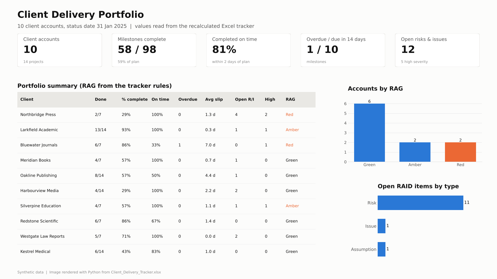

# Project Management & Client Delivery Tracker

A client-delivery tracker for a portfolio of **10 client accounts**: projects, milestones (planned / forecast / actual),
a RAID log and a one-click weekly status report, built as a **formula-driven Excel workbook**.

> **Synthetic data.** Clients, projects, milestones and RAID items were generated by `build_tracker.py` (seed 81); client
> names are invented. It reflects how I track client accounts, milestones, timelines and risks as a Project Management
> Executive, rebuilt on made-up data so it can be shared.



## The workbook (`Client_Delivery_Tracker.xlsx`)
| Sheet | What it does |
|---|---|
| Portfolio Summary | One row per client: % complete, on-time %, overdue, due in 14 days, average slip, open risks / issues, **RAG**. One input: the **status date**. |
| Milestones | 98 milestones with formulas for done, slip (days), overdue, due soon and milestone RAG |
| RAID Log | Risks, assumptions, issues, dependencies with severity, owner, due date, days open, past-due flag |
| Projects | Project list with owner, start date and budget hours |
| Client Status Report | Pick a client from the drop-down: KPIs pulled with INDEX/MATCH, plus a commentary block for the weekly status mail |
| How To Use | Update steps and colour legend |

All KPIs are Excel formulas (COUNTIFS, AVERAGEIF, INDEX/MATCH, a named `StatusDate`), so changing the status date or a
milestone date re-runs every status. The workbook was recalculated with **0 formula errors**.

**RAG rule:** Red = a milestone overdue by more than 7 days or 2+ high-severity open items; Amber = any overdue milestone,
average slip over 5 days or 1 high-severity item; otherwise Green.

## Status at 31 Jan 2025 (synthetic)
- 58 of 98 milestones complete (59%); **81%** completed within 2 days of plan.
- 1 milestone overdue and 10 due in the next 14 days.
- **Red accounts:** Northbridge Press, Bluewater Journals. 12 open risks / issues, 5 of them high severity.

## Repository structure
```
project-management-client-delivery-tracker/
├── build_tracker.py               generates the data and the workbook
├── Client_Delivery_Tracker.xlsx
├── Data/                          Projects.csv, Milestones.csv, RAID_Log.csv
├── Images/Portfolio_Summary.png
├── LICENSE
└── README.md
```

## How to run
```bash
pip install pandas numpy openpyxl
python build_tracker.py
```

## Skills shown
Project tracking (milestones, slip, RAG) · RAID management · client status reporting · Excel (COUNTIFS, INDEX/MATCH, named ranges,
data validation, conditional formatting)

## Author
**Balaji R** · Business Analyst | Business Intelligence | Project Coordination
[LinkedIn](https://www.linkedin.com/in/balaji-r-98581b105) · balajidx14@gmail.com

## License
MIT. See [LICENSE](LICENSE).
